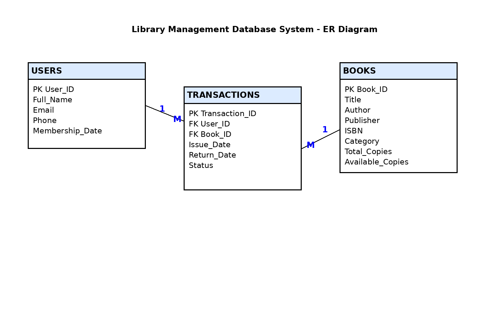

# library-management-database-system
A MySQL-based relational database project designed to manage library books, users, and book transactions.

The system enables:
- Book management
- User registration
- Book issuing
- Book returns
- Transaction tracking
- Overdue book monitoring

This project demonstrates the practical implementation of:
- DBMS concepts
- Relational databases
- Primary & Foreign Keys
- SQL Queries
- Joins
- Transactions and ACID properties

## Technologies

- MySQL 8.0
- SQL
- MySQL Workbench

## ER Diagram



## Tables

### Books
- Book_ID (PK)
- Title
- Author
- Publisher
- ISBN
- Category
- Total_Copies
- Available_Copies

### Users
- User_ID (PK)
- Full_Name
- Email
- Phone
- Membership_Date

### Transactions
- Transaction_ID (PK)
- User_ID (FK)
- Book_ID (FK)
- Issue_Date
- Return_Date
- Status

## Features

✅ Add books

✅ Register users

✅ Issue books only when a copy is available

✅ Return only currently issued or overdue transactions

✅ Track book availability safely with row locking

✅ Store due dates and calculate overdue status

✅ Validate inventory quantities and date values

✅ View transaction history

✅ Monitor overdue books

✅ Prevent a user from borrowing the same book twice at once

✅ Validate email and ISBN formats

✅ Track fine amounts and payment status

✅ Maintain creation and update audit timestamps

✅ Index foreign keys and frequently queried fields

✅ Automatically refresh overdue status with a scheduled event

## Issue and Return Procedures

Use these stored procedures instead of updating tables manually:

```sql
CALL Issue_Book(1, 1, CURDATE(), 15);
CALL Return_Book(1, CURDATE());
CALL Refresh_Overdue_Status();
CALL Mark_Fine_Paid(1);
```

`Issue_Book` verifies that the user and book exist and that at least one copy is available. It then creates the transaction and deducts inventory inside the same transaction. `Return_Book` verifies that the transaction is active and has not already been returned before adding one copy back. `Refresh_Overdue_Status` marks due loans overdue and can restore an issued status if a transaction's due date is corrected. `Mark_Fine_Paid` updates the fine payment status for a transaction.

## SQL Concepts Implemented

- CREATE DATABASE
- CREATE TABLE
- INSERT
- UPDATE
- DELETE
- SELECT
- WHERE
- ORDER BY
- INNER JOIN
- FOREIGN KEY
- PRIMARY KEY
- TRANSACTIONS
- ACID PROPERTIES

## Sample Queries

SELECT * FROM Books;

SELECT * FROM Users;

SELECT *
FROM Transactions;

## Setup

1. Install MySQL.
2. Open MySQL Workbench.
3. Execute schema.sql.
4. Execute sample_data.sql.
5. Run queries.sql.

